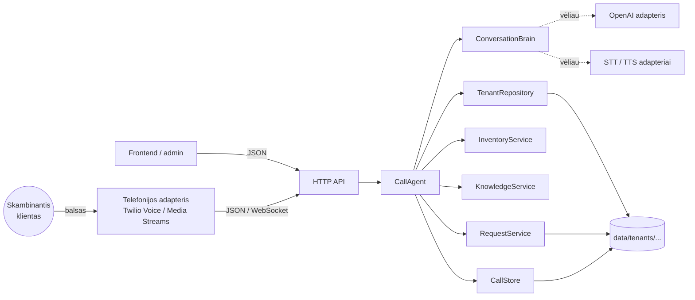
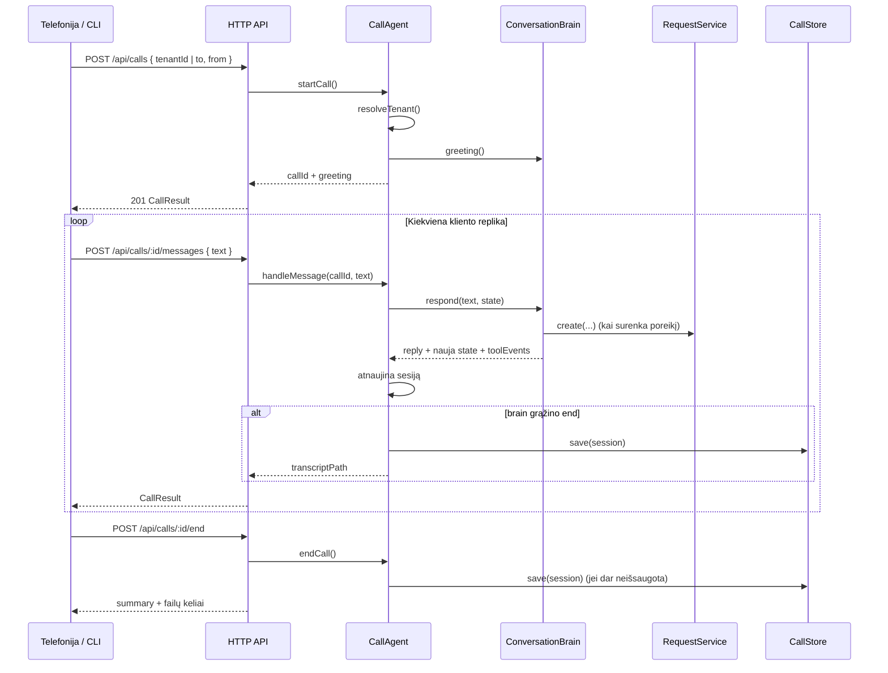
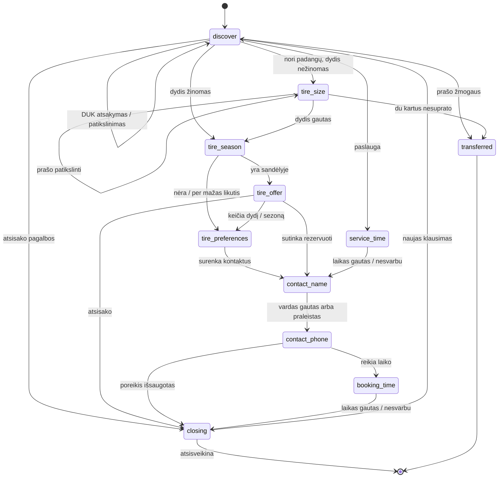
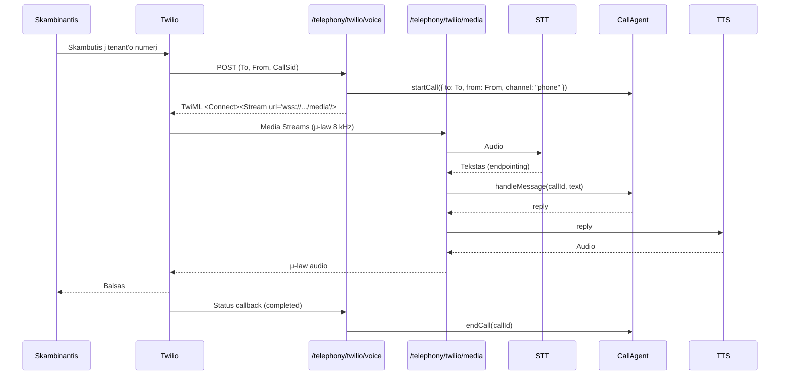

# ChatCall architektūra

Šis dokumentas aprašo, kaip veikia dabartinė (mock) versija ir kaip prie jos prijungti LLM, telefoniją bei produkcinę saugyklą neperrašant verslo logikos.

## 1. Tikslas ir ribos

**Tikslas:** multi-tenant inbound skambučių centro backend’as, kuris:

- atpažįsta tenant’ą pagal skambinamą numerį arba `tenantId`;
- išsiaiškina kliento poreikį (padangos, paslauga, DUK, operatorius);
- patikrina konkretaus tenant’o sandėlį ir pasiūlo arba rezervuoja prekę;
- kai prekės nėra, surenka poreikį ir kontaktus bei išsaugo juos failuose;
- atsako į DUK ir perduoda žmogui, kai to prašoma arba nepavyksta suprasti;
- išsaugo pokalbio transkriptą ir santrauką.

**Ne šio repo ribos:** svetainė, admin UI, mokėjimai, SMS, realus kalendorius, produkcinė autentifikacija.

Dabartinis „protas“ yra deterministinis `RuleBasedBrain`. Tikras STT/TTS, Twilio ir OpenAI jungiami adapteriais.

## 2. Kontekstas



Dabartinėje versijoje `Telephony` ir `Frontend` vaidmenį atlieka CLI arba HTTP klientas. `CallAgent` nežino, ar tekstas atėjo iš terminalo, ar iš STT.

## 3. Sluoksniai ir priklausomybės

```text
src/
├── domain/       # tipai, jokios I/O logikos
├── lib/          # tekstas, datos, atominių failų saugykla
├── tenants/      # tenant konfigūracijos įkėlimas ir paieška pagal telefoną
├── inventory/    # sandėlio filtravimas ir alternatyvos
├── knowledge/    # DUK ir paslaugų paieška
├── requests/     # kliento poreikių išsaugojimas (JSON/MD/CSV)
├── calls/        # transkriptų išsaugojimas
├── agent/        # CallAgent, ConversationBrain, RuleBasedBrain, santrauka
├── api/          # HTTP adapteris
└── cli/          # demo adapteriai
```

Priklausomybių kryptis: `api` / `cli` → `agent` → paslaugos → `lib` → `domain`.

- `agent` neturi importuoti `api` ar `cli`.
- `domain/types.ts` neturi importuoti paslaugų.
- `ConversationBrain` gauna tik `TenantContext` ir `BrainDeps`; jis nežino apie HTTP, Twilio ar failų kelius.

`CallAgentDeps` leidžia įterpti visas paslaugas, todėl testuose ir produkcijoje galima pakeisti saugyklą nekeičiant orkestratoriaus:

```ts
new CallAgent({
  dataDir,
  tenants,     // TenantRepository
  inventory,   // InventoryService
  knowledge,   // KnowledgeService
  requests,    // RequestService
  calls,       // CallStore
  brainFactory // (ctx, deps) => ConversationBrain
});
```

## 4. Multi-tenancy

### Tenant’o parinkimas

`CallAgent.startCall()` eiliškumas:

1. Jei perduotas `tenantId` — naudojamas jis.
2. Jei perduotas `to` (skambinamas numeris) — ieškoma tenant’o, kurio `tenant.json → phone` atitinka numerį.
3. Jei yra tik vienas tenant’as — naudojamas jis.
4. Kitu atveju grąžinama klaida.

Telefonai lyginami per `normalizePhone()`: `+370 600 00000`, `00370...`, `8 600...` ir `370...` variantams gaunamas vienodas `+3706...` formatas.

### Izoliacija

- Visi duomenys saugomi `data/tenants/<tenant-id>/` kataloge.
- Sandėlio, DUK ir paslaugų paieška vyksta tik su to tenant’o `TenantContext`.
- Poreikiai ir skambučiai rašomi tik į to tenant’o `requests/` ir `calls/` katalogus.
- `tenant.json → id` turi sutapti su katalogo pavadinimu; tai tikrinama įkeliant.

**Produkcijai būtina:** tenant’ą imti iš autentifikuoto telefono numerio arba API rakto, o ne iš kliento siunčiamo `tenantId`. Dabartinis API yra atviras ir skirtas tik demo/testavimui.

## 5. Skambučio gyvavimo ciklas



Sesijos laikomos `CallAgent` atmintyje (`Map<callId, ActiveCall>`). Tai reiškia:

- aktyvūs skambučiai išlieka tik viename procese;
- perkraunant serverį jie prarandami;
- horizontaliam skalavimui reikės `SessionStore` (Redis/DB) ir užklausų rutinavimo į tą patį procesą.

## 6. Būsenų mašina

`CallState.phase` yra pagrindinė pokalbio būsena. `RuleBasedBrain` kiekvienos replikos metu nusprendžia, kurią būseną grąžinti.



Svarbios taisyklės:

- **Atsisveikinimas** (`isGoodbye`) baigia pokalbį iš bet kurios būsenos.
- **Prašymas žmogaus** (`isHumanRequest`) iškart perduoda operatoriui.
- **DUK pertraukimas:** kai kuriose būsenose klausimas su `?` arba klausiamuoju žodžiu pirmiausia bandomas atsakyti iš DUK, o tada grįžtama prie tos pačios būsenos.
- **`unknownTurns`:** po dviejų nesuprastų replikų (ten, kur ši apsauga įjungta) siūlomas operatorius.
- **`awaitingHumanConfirmation`:** jei klientas patvirtina — perjungiama; jei ne — pokalbis tęsiamas.
- **`needsTime()`:** laikas klausiamas paslaugų rezervacijai ir tik tada, kai prekė yra sandėlyje. Užsakymui „iš sandėlio“ laikas nebūtinas.

### `CallState` laukai

| Laukas | Paskirtis |
| --- | --- |
| `phase` | Dabartinis pokalbio žingsnis |
| `intent` | `tires`, `service`, `faq`, `human`, `other` |
| `customerName`, `phone` | Kontaktai |
| `vehicle` | Automobilio markė / modelis |
| `tireSize`, `season`, `brandPreference`, `budget`, `quantity` | Padangų poreikis |
| `service`, `preferredTime` | Paslaugos rezervacija |
| `offer` | Pasiūlyti sandėlio variantai |
| `inStock` | Ar rastas tinkamas variantas |
| `pendingRequestType` | Kokį poreikį kurs (`parts_order`, `service_booking`, `callback`) |
| `requestId` | Sukurto poreikio ID |
| `notes` | Žmogui skirtos pastabos |
| `transferReason` | Perdavimo priežastis |
| `awaitingHumanConfirmation` | Ar laukiama atsakymo į pasiūlymą perduoti |
| `unknownTurns` | Nesuprastų replikų skaitiklis |

## 7. `ConversationBrain` sutartis

```ts
interface ConversationBrain {
  greeting(): string;
  respond(text: string, state: CallState): Promise<BrainResponse>;
}

interface BrainResponse {
  reply: string;
  state: CallState;
  events: ToolEvent[];
  end?: boolean;
  transferred?: boolean;
}
```

Taisyklės, kurių turi laikytis bet kuri implementacija (įskaitant LLM):

1. **Negrąžinti to paties objekto mutavus.** `RuleBasedBrain` pradeda nuo `cloneState()`.
2. **Grąžinti pilną naują `CallState`**, o ne tik pakeitimus.
3. **Nepatvirtinti sandėlio ar kainos be paslaugos atsakymo.** Visi faktai apie likutį, kainą ir paslaugas turi ateiti iš `InventoryService` / `KnowledgeService`.
4. **Įrašyti `ToolEvent`** kiekvienam įvykdytam veiksmui (`ok` ir `error` atvejais).
5. **`end: true`** reiškia, kad `CallAgent` išsaugos transkriptą. `transferred: true` taip pat užbaigia skambutį ir pažymi jį kaip perduotą.
6. **Neatlikti failų I/O pačiam** — tam naudoti `RequestService` ir `CallStore`.

### `RuleBasedBrain` prioritetų tvarka

1. Tuščia replika → paprašyti pakartoti.
2. Atsisveikinimas → uždaryti.
3. Prašymas žmogaus → perduoti.
4. Neigiamas atsakymas `discover` / `closing` fazėje be pasiūlymo → uždaryti.
5. Entity išgavimas (`applyEntities`): dydis, sezonas, kiekis, biudžetas, automobilis, laikas, vardas, telefonas, gamintojas.
6. Laukiantis operatoriaus patvirtinimas.
7. Fazių apdorojimas (`switch`).
8. `discover`: paslaugos + padangų patikslinimas → padangos → paslauga → DUK → patikslinimas / operatorius.

Tekstas normalizuojamas: mažosios raidės, lietuviški diakritikai pašalinami, skyryba paverčiama tarpais. Todėl `žieminės`, `ziemines` ir `ŽIEMINĖS` atpažįstamos vienodai.

### Ką reiškia „mock“

`RuleBasedBrain` nenaudoja LLM ir nevykdo tinklo užklausų. Jis:

- atpažįsta ketinimą pagal raktinius žodžius;
- ištraukia dydį, sezoną, kiekį, biudžetą, telefoną ir laiką reguliariosiomis išraiškomis;
- kviečia tas pačias paslaugas, kurias vėliau kvies LLM;
- generuoja lietuviškus atsakymus iš šablonų.

Tai leidžia testuoti visą verslo logiką be API raktų ir be tinklo.

## 8. Įrankių (tool) sutartys

Šios sutartys apibrėžia, ką gali daryti protas. Dabartinis `RuleBasedBrain` dalį jų kviečia tiesiogiai per `BrainDeps`, o `ToolEvent` naudoja auditui.

| Tool | Įvestis | Rezultatas | Šalutinis poveikis |
| --- | --- | --- | --- |
| `check_stock` | `StockQuery` (`size`, `season`, `brand`, `quantity`, `text`) | `StockResult` (`matches`, `alternatives`) | Nėra |
| `list_services` | — | `Service[]` | Nėra; rezervuota LLM adapteriui |
| `get_business_info` | `faqId` arba tema | `FaqEntry` | Nėra |
| `create_request` | `CreateRequestInput` | `CreatedRequest` (`request`, `jsonPath`, `mdPath`) | Rašo JSON/MD/CSV į tenant’o `requests/` |
| `transfer_to_human` | `reason`, `phone?` | Patvirtinimas | Žymi skambutį perduotu; tikras perjungimas — telefonijos adapterio |
| `end_call` | `reason` | Patvirtinimas | Užbaigia sesiją ir išsaugo transkriptą |

Pastaba: `ToolName` jau turi `list_services`, bet dabartinis mock paslaugų sąrašo kaip atskiro įvykio nerašo — jis naudoja `KnowledgeService.findService()`. LLM adapteryje šis tool turi būti realizuotas, jei modeliui reikia matyti visą paslaugų sąrašą.

### `create_request` duomenys

```ts
{
  type: "parts_order" | "service_booking" | "callback",
  status: "new" | "pending_confirmation" | "transferred",
  customer: { name?, phone? },
  vehicle?,
  items: RequestItem[],
  service?,
  preferredTime?,
  notes?,
  summary
}
```

Statuso logika:

- `parts_order` su `inStock === true` → `pending_confirmation` (rezervacija);
- `service_booking` → `pending_confirmation`;
- `parts_order` be sandėlio → `new` (užsakymas);
- `callback` → `new`.

## 9. Duomenų saugojimas

```text
data/tenants/<tenant-id>/
├── tenant.json
├── services.json
├── inventory.json
├── faq.json
├── requests/
│   └── YYYY-MM-DD/
│       ├── REQ-YYYYMMDD-XXXXXX.json
│       ├── REQ-YYYYMMDD-XXXXXX.md
│       ├── poreikiai.md
│       └── poreikiai.csv
└── calls/
    └── YYYY-MM-DD/
        ├── call_<uuid>.json
        └── call_<uuid>.md
```

- Data ir laikas imami tenant’o `timezone` (numatytai `Europe/Vilnius`).
- JSON rašomas atominiu būdu (laikinas failas + rename), kad nebūtų pusiau įrašyto failo.
- `REQ-...md` — vieno poreikio kortelė žmogui.
- `poreikiai.md` ir `poreikiai.csv` — dienos suvestinė, papildoma po kiekvieno poreikio.
- `calls/*.md` — transkriptas su santrauka, rezultatu ir kitu veiksmu.
- `requests/` ir `calls/` turinys ignoruojamas git’e; `.gitkeep` išimtys palieka katalogus repo struktūroje.

**Apribojimas:** dienos suvestinė papildoma be failų užrakto. Vienam procesui to pakanka; keli procesai ar didelis srautas reikalauja DB arba eilės.

## 10. HTTP API

| Metodas | Maršrutas | Ką daro |
| --- | --- | --- |
| `GET` | `/health` | Sveikatos patikra |
| `GET` | `/api/tenants` | Tenant’ų sąrašas su duomenų kiekiais |
| `POST` | `/api/calls` | Pradeda skambutį |
| `POST` | `/api/calls/:id/messages` | Priima kliento tekstą |
| `GET` | `/api/calls/:id` | Grąžina aktyvią sesiją |
| `POST` | `/api/calls/:id/end` | Baigia ir išsaugo skambutį |
| `GET` | `/api/tenants/:id/requests?date=YYYY-MM-DD` | Grąžina tenant’o poreikius |

Klaidos:

- `400` — neteisingas JSON, trūksta lauko, neteisingas `date` formatas;
- `404` — nerastas maršrutas, tenant’as arba skambutis;
- `409` — skambutis jau baigtas;
- `413` — užklausa didesnė nei 1 MB;
- `500` — vidinė klaida (detalės log’inamos, klientui negrąžinamos).

**Produkcijai trūksta:** autentifikacijos, tenant’o scope’o, rate limiting, HTTPS ir CORS apribojimo. Dabar `Access-Control-Allow-Origin: *`.

## 11. Twilio prijungimo planas

Tikslas: tas pats `CallAgent` ir `ConversationBrain`, tik vietoj tekstinio API atsiranda balso adapteris.



### Reikalingi adapteriai

```text
src/telephony/
├── twilioWebhook.ts   # TwiML, parašo validacija, CallSid → callId
├── mediaStream.ts     # WebSocket, audio rėmeliai, barge-in
└── audio.ts           # μ-law ↔ PCM, formatų konversija

src/speech/
├── stt.ts             # STT sąsaja + Twilio/Deepgram/Whisper adapteris
└── tts.ts             # TTS sąsaja + adapteris
```

### Ką reikia pakeisti

1. **Sesijų saugykla.** `CallAgent.active` yra procesinis `Map`. Telefonijai reikia `SessionStore` pagal `CallSid` → `callId`, kad webhook’ai ir WebSocket’ai rastų tą pačią sesiją.
2. **Nutraukimo apdorojimas.** Twilio `statusCallback` turi kviesti `endCall()`, net jei klientas padėjo ragelį.
3. **Barge-in.** Kai klientas pradeda kalbėti, TTS grojimas turi būti sustabdytas, o STT įjungtas.
4. **Perdavimas.** `transfer_to_human` turi grąžinti TwiML `<Dial>` į `tenant.transferPhone` arba perjungti stream’ą į operatorių.
5. **Saugumas.** Validuoti `X-Twilio-Signature`, naudoti `wss://`, slaptažodžius laikyti `.env`.
6. **Latency.** Tikslas — iki ~1,5 s nuo kliento pauzės iki pirmo balso. Tam reikia streaming STT, trumpo LLM atsakymo ir streaming TTS.

### Aplinkos kintamieji (planuojami)

```dotenv
TELEPHONY=twilio
TWILIO_ACCOUNT_SID=
TWILIO_AUTH_TOKEN=
TWILIO_PHONE_NUMBER=
PUBLIC_BASE_URL=https://...
STT_PROVIDER=
STT_API_KEY=
TTS_PROVIDER=
TTS_API_KEY=
```

## 12. OpenAI / LLM prijungimo planas

### Adapteris

Sukurti `OpenAiBrain implements ConversationBrain` ir perduoti jį į `CallAgent`:

```ts
new CallAgent({
  dataDir,
  brainFactory: (ctx, deps) => new OpenAiBrain(ctx, deps, {
    apiKey: process.env.OPENAI_API_KEY!,
    model: process.env.OPENAI_MODEL ?? "gpt-4.1-mini",
  }),
});
```

Verslo logika (`CallAgent`, paslaugos, failų formatas, API) nesikeičia.

### Prompt’o turinys

- tenant’o pavadinimas, adresas, darbo laikas, perdavimo telefonas;
- paslaugų sąrašas ir kainos;
- DUK;
- dabartinis `CallState` ir paskutinės 6–10 replikų;
- instrukcija kalbėti lietuviškai, trumpai, telefoninio pokalbio stiliumi;
- draudimas išgalvoti likutį, kainą ar terminą;
- prašymas grąžinti struktūrizuotą atsakymą.

### Struktūrizuotas atsakymas

```ts
{
  reply: string,
  statePatch: Partial<CallState>,
  toolCalls: Array<{ name: ToolName, input: unknown }>,
  end?: boolean,
  transferred?: boolean
}
```

Adapteris turi:

1. Įvykdyti `toolCalls` per tas pačias paslaugas.
2. Sujungti `statePatch` su esamu state ir **validuoti** kritinius laukus (telefonas, dydis, sezonas, kiekis, kaina).
3. Neleisti modeliui tiesiogiai rašyti failų.
4. Grąžinti `ToolEvent[]` ir pilną `CallState`.

### Saugikliai

- Jei LLM atsako klaida, timeout’u arba netinkamu JSON — vienai replikai naudoti `RuleBasedBrain` arba atsiprašyti ir pasiūlyti operatorių.
- Niekada neteigti „turime sandėlyje“, jei `check_stock` negrąžino `available: true`.
- Niekada neteigti konkrečios kainos, jei jos nėra `InventoryService` / `KnowledgeService` rezultate.
- Telefono numerį ir vardą validuoti prieš `create_request`.
- Neleisti perduoti skambučio be aiškios priežasties arba kliento prašymo.
- Log’uose nerodyti pilno telefono numerio ir transkripto produkcijoje be pagrindo.

### Testavimas

- Tie patys scenarijų testai turi veikti su abiem protais (contract tests).
- LLM testams naudoti įrašytus atsakymus (fixtures), o ne gyvą API.
- Atskirai testuoti: netinkamą JSON, tool klaidą, timeout’ą, halucinuotą kainą.

## 13. Ką keisti augant

| Dabartinis sprendimas | Produkcinis variantas |
| --- | --- |
| `tenant.json` failai | DB + admin UI; `TenantRepository` interface |
| `inventory.json` | POS / ERP / sandėlio API; periodinis cache |
| `RequestService` į failus | DB + CRM webhook + eilė |
| `CallStore` į failus | Object storage + DB indeksas |
| `CallAgent.active` `Map` | Redis / DB sesijos, TTL, keli procesai |
| `RuleBasedBrain` | `OpenAiBrain` + fallback |
| HTTP be autentifikacijos | API raktai / OAuth, tenant scope, rate limit |
| `console.log` | struktūrizuoti log’ai, metrics, tracing |
| Dienos suvestinė be užrakto | DB transakcijos arba eilė |

## 14. Sprendimų santrauka

- **Failai, ne DB:** greitas MVP, lengva peržiūrėti poreikius Excel’yje, jokių išorinių priklausomybių.
- **Deterministinis protas:** testuojama ir demo’inama be raktų; LLM vėliau keičiamas per `ConversationBrain`.
- **Paslaugos, o ne tiesioginis I/O:** LLM ir telefonija naudoja tą pačią verslo logiką.
- **Sesijos atmintyje:** paprasta vienam procesui; žinomas skalavimo apribojimas.
- **Lietuviški duomenys ir tekstai:** kalba yra turinys, ne UI; DUK ir paslaugos keičiamos tenant’o failuose.

## 15. Tolimesni žingsniai

1. Pridėti `OpenAiBrain` ir `BRAIN=rule|openai` konfigūraciją.
2. Padaryti `TenantRepository` / `RequestService` / `CallStore` sąsajas ir DB adapterius.
3. Pridėti `SessionStore` ir telefono `CallSid` susiejimą.
4. Įdiegti Twilio webhook + Media Streams + STT/TTS.
5. Pridėti autentifikaciją, rate limiting ir observability.
6. Praplėsti testus: LLM contract, telephony adapter, ilgi pokalbiai, nutrūkę skambučiai.
